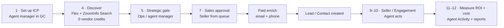

# Adecco Prospecting Agent: Design Overview

> **Owner (UX):** Prayas Mandpe · **PM:** Victor Weilin Liu · **Status:** working brief, Oct 28, 2026
> **Sources:** *Prospecting Agent – Adecco Product Requirements* (PRD, last updated Oct 24–25) + `#adecco-prospecting-warroom` (C0CBNJX3PNU), Oct 23–28.
> **Legend:** 🟢 ships in **264.11 (Nov 7)** · 🟡 **264.12 (Nov 14)** · 🔵 264.10 patch (already in flight) · ⚪ later / not scheduled

This is the index and shared context for the per-workstream design briefs. Read this first, then open the brief for the area you are designing.

| # | Brief | What it covers | .11 UX load |
|---|---|---|---|
| 01 | [Prospecting Enhancements](01-prospecting-enhancements.md) | GC config: contact requirements / DNC, skip-enrich (Account + Prospect), skip cooldown, cooldown preview flag, cooldown window, broad-ICP preview | **High** |
| 02 | [Agent Activity](02-agent-activity.md) | Run log: run summary, match details, enrich count, Flex, disqualified-but-charged, report type, error states | **Highest** |
| 03 | [Custom Approval Workflows](03-custom-approval-workflows.md) | Record Creation = Prospects (staging), Flow 1 (product) vs Flow 2 (FDE) | Low (label + setup text) |
| 04 | [Queue Support](04-queue-support.md) | Distribute to a queue, queue picker, licensed members | None (post-.11) |
| 05 | [Multiple ICPs](05-multiple-icps.md) | ICP sizing (P0), ICP groups, ranking, routing | None (sizing is next) |
| 06 | [Miscellaneous](06-miscellaneous.md) | Agent deletion, max-prospects limit, Agent Details summary | None |

---

## 1. Situation

- Adecco (UK staffing) is an **escalated account**. Trust had broken down, and exec sponsors (Ramesh, Arvind, Kris, Patrick) get daily updates from Kunal. The whole team worked the weekend of Oct 24–25.
- Victor named Prayas UI owner ("For UI, we'll work with Prayas"). Issa and Nima are mostly unavailable.
- **Eng is building GC changes without final UX.** The proto's job is to settle **placement and copy** quickly so eng and CX (Patricia Vaz) can ship behind gates.
- Victor, Oct 27: *"functional gaps like payload being too large and breaking the preview should be fixed … atm, the issue is trust."* Every design choice should favor **explainability and predictability** over cleverness.

## 2. Adecco's target workflow (steel thread)

**Updated by the customer on Oct 27 (Victor's post, ts 1793117037).** This changes the PRD's Flow 2:
> "keep the prospect in staging after Ops approval and assign it to the relevant Sales queue for review. The **Lead should only be created once Sales has approved** the prospect. The Ops approval is primarily intended as a safety and volume control …"
> On Sales rejection: "no Lead should exist yet … The prospect should remain in staging with a **rejected status and, ideally, the rejection reason**."

## 3. Customer design principles (their words, Oct 27)

| Principle | Quote | Design implication |
|---|---|---|
| ROI first, enrich late | "maintaining a viable ROI … avoiding paid enrichment wherever possible and, when it is required, triggering it as late as possible" | Paid enrich is **off by default** and clearly labeled as a cost. Never imply that "off = worse". |
| Predictable + explainable | "We need predictable and explainable results" | Per-criterion match details. No unexplained counts or chips. |
| Volume visibility | "giving Ops an indication of the expected account and prospect population so that an ICP that is too broad or too restrictive can be identified early" | ICP sizing / output-size preview in GC (Tab 5 #1, post-.11 priority). |
| Cost transparency | "distinguish between an enrichment call being made, actual ZoomInfo credit consumption, and cases where enrichment does not generate an additional charge" | Agent Activity cost vocabulary: **call ≠ credit ≠ no-charge**. v1 shows calls only. |
| One process, many ICPs | "avoid having one agent per ICP … the ICP acts as a reusable template" | Multi-ICP stays a later model, but avoid GC patterns that assume one ICP forever. |

## 4. Cost vocabulary (use these terms consistently in all designs)

| Term | What it is | Costs | Where it shows |
|---|---|---|---|
| **ZoomInfo Search** | Filtered query that returns name, company, title (seniority soon) and has* flags (hasEmail, hasDirectPhone …) | **0 vendor credits** | Not counted in Agent Activity |
| **ZoomInfo Enrich** | Paid call that returns full email/phone/firmographics for one person or company | **1 credit** per call (0 if enriched within the ~12-month records-under-management window) | v1: **count of enrich calls** (not credits) |
| **Flex credits** | Salesforce consumption for anything hitting LLM Gateway (research, web search, prompts) | Always > 0 for every processed record | Per run + per account (Digital Wallet) |

Kunal and Victor (Flex thread, ts 1792857927): v1 reports **number of enrich API calls**, not credits, to avoid billing disputes. Actual credit consumption moves to after .11.

## 5. Release map

| Release | Scope (UX-relevant) |
|---|---|
| 🔵 **264.10 patch** | Skip cooldown ("Process All Accounts" in Advanced Settings), agent deletion |
| 🟢 **264.11 (Nov 7)** | Agent Activity P0s · contact pre-filter (email OR callable phone; DNC = no phone) · skip-enrich Account + Contact toggles (per agent, GC) · Record Creation = Prospects (staging, gated) · error-handling fixes · max prospects 5 → 100 |
| 🟡 **264.12 (Nov 14)** | Accuracy work · ZoomInfo "research connection" (non-billable search routing, W-24651730) |
| ⚪ **After .11** | ICP sizing in GC (Victor's next GC priority) · actual credit consumption · queues on the prospect entity · multi-ICP routing spike · Flow 1 approval step · configurable cooldown · configurable "require email/phone" |

Neeraj's .11 scope summary (ts 1792883998): *"264.11 is scoped down to two independent features, gated or hardcoded for this one customer: 1. Contact pre-filter … 2. Skip-enrich before approval: separate account and contact toggles, off by default … per agent setting in GC in .11."*

## 6. Gates

| Gate | Covers |
|---|---|
| `com.salesforce.bluebirds.prospectingadeccoenhancements` | Staging prospects (Record Creation = Prospects) |
| `com.salesforce.bluebirds.errorhandling` | All 264.11 patch changes (Ronit, Oct 23) |
| `com.salesforce.bluebirds.zoominfoskipenrichnoemail` | Contact pre-filter after Search (Megan) |
| `com.salesforce.bluebirds.leaddedupefindduplicates` | Lead dedupe |
| `com.salesforce.bluebirds.skipaccountfilters` | Account filter skipping |

**Design implication:** every new GC control must also look right when its gate is **off**. That means it is hidden, with no empty section headers left behind.

## 7. People

| Area | People |
|---|---|
| PM / leadership | Victor Weilin Liu (PM, PRD owner) · Kunal Punera (leader) · Neeraj Agicha (eng lead) |
| Cooldown / Advanced Settings | Rajkumar Pellakuru, Tanuja Tammireddy |
| Skip enrich toggles | Jonathan Tang (patch doc: *Skip Contact Enrich or Skip Account Enrich*, 264.11) |
| ZoomInfo filter / matching | Megan Zhu, Sam Casacio (preview limits, research connection), Siddarth Sampangi (existing CRM contacts) |
| Staging / data model | Rebecca Greenberg, Shashank Tejura, Rohini Thakar, Caleb Smith, Thomas Morrow (GC entity UI), Jason Levens |
| Agent Activity / credits / errors | Shrey Kharbanda, Sahil Godhane, Ronit Batchu, Matt Holland, Vandana Ramesh |
| QA | Mukesh Dua, Manika Sunal (Q3) · Kiran Kamath M (Q4 perf) |
| CX / content | Patricia Vaz · Cordelia Hsiao (product/content input on labels) |
| UX | Prayas Mandpe (owner) · Issa Mao, Nima Motamedi |
| FDE | Giuseppe Cardace (Adecco FDE; tech channel: `#adecco-prospecting-agent-technical-discussions`) |

## 8. Cross-cutting design themes

1. **Explain every number.** A count without a list and a reason behind it erodes trust. Manika's QA examples: "2 not added", the Enriched counts, and failed-account messages.
2. **Cost is a first-class signal.** Whenever a setting changes cost, say so inline: skip cooldown → Flex every run; enrich on → vendor credits.
3. **Search ≠ CRM-only.** With enrich off, the agent still uses ZoomInfo **Search**. The current proto copy "limits results to your CRM data only" is wrong and must change.
4. **Gated, Adecco-first, product-shaped.** Ship controls that make sense for every customer, even though only Adecco has them on in .11.
5. **Human error messages.** No raw codes (AG009/AG010) or orchestrator text. Every error state needs a cause and a next step.

## 9. Proto inventory (repo: `prayas-adecco-prospecting-agent`)

Static SLDS HTML, forked from Issa's proto. Published at `git.soma …/pages/scg-design-engineering/proto-kit/seller-ex/prayas-prospecting-agent/lex-slds/`.

| File | Role | Status for .11 |
|---|---|---|
| `step_01_select_accounts.html` | Add Sources | – |
| `step_02_account_research.html` | Account Research | **Needs** Account skip-enrich toggle + cooldown preview flag |
| `step_03_find_prospects.html` | Find Prospects | Has Contact Requirements + Third-Party Enrichment. **Copy bug**, needs DNC helper + warning |
| `step_05_prospect_assignment.html` | Assign Prospects + **Advanced Prospecting Settings modal** (chosen approach) | Process All Accounts needs a warning box. Record Creation has Prospects option |
| `step_05_prospect_assignment.html` | Tabbed Advanced Settings (alternate, not chosen) | Reference only |
| `step_06_review_activate.html` | Review & Activate | Could summarize the new settings (see 06) |
| `prospect_list.html` + `scripts/agent-log.js`, `scripts/prospect-list.js` | Prospecting tab with **Activity** + Insights tabs, "Flex Credit Used", View Details | Base for Agent Activity (02) |
| `agent_monitoring.html` | Agent monitoring | Reference |
| `PLAN.md` | **Stale.** Describes a Nuxt/protokit build that isn't what's in the repo | Ignore / replace |

⚠️ Kunal: the Heroku `prospect-list-p0.html` Logs prototype linked in the PRD is old and doesn't reflect the real build. **Do not show it to the customer.** Design against the real Agent Activity build.

## 10. Consolidated open decisions (for Victor / eng / CX)

| # | Decision | Brief | Owner |
|---|---|---|---|
| D1 | Skip-enrich toggle placement: **PRD = on Account Research + Find Prospects steps** (our design) vs eng's current "for today" spot in Advanced Settings → Record Creation | 01 | Victor, Jonathan |
| D2 | Final labels and warning copy for skip-enrich (CX request open in C0BBVJZKEC8) | 01 | Patricia |
| D3 | Process All Accounts: warning text, and whether it later becomes manual-run-only | 01 | Victor, Rajkumar, Patricia |
| D4 | Contact Requirements in .11 is hardcoded (email OR callable phone). Do we show it as a read-only statement, or hide the control until configurable? | 01 | Victor, Megan |
| D5 | Prospect match details: per-criterion format (needs LLM prompt change + cost) vs current free-text rationale for v1 | 02 | Victor, Shrey |
| D6 | Record every filtered-out contact (up to 2,000 per account) or only counts? | 02 | Victor, Shrey, Megan |
| D7 | Record Creation label: "Prospects" vs keep Leads/Contacts + separate "human in the loop" option | 03 | Patricia, Cordelia, Victor |
| D8 | Rejection reason capture and status design for staged prospects | 03 | Victor, FDE |
| D9 | ICP sizing / output-size preview: format and where it lives in GC | 05 | Victor |
| D10 | Show an Advanced Settings summary on Agent Details? (on hold) | 06 | Neeraj, Mukesh |
